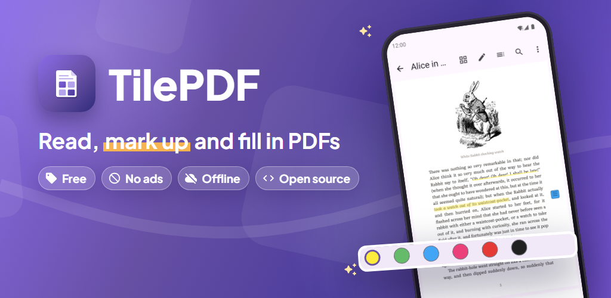
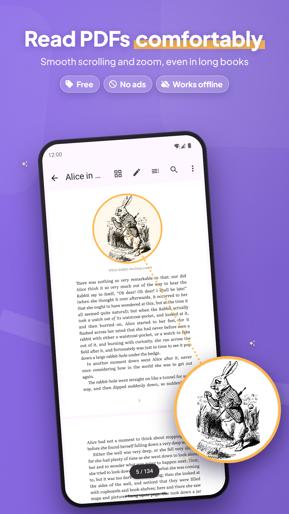
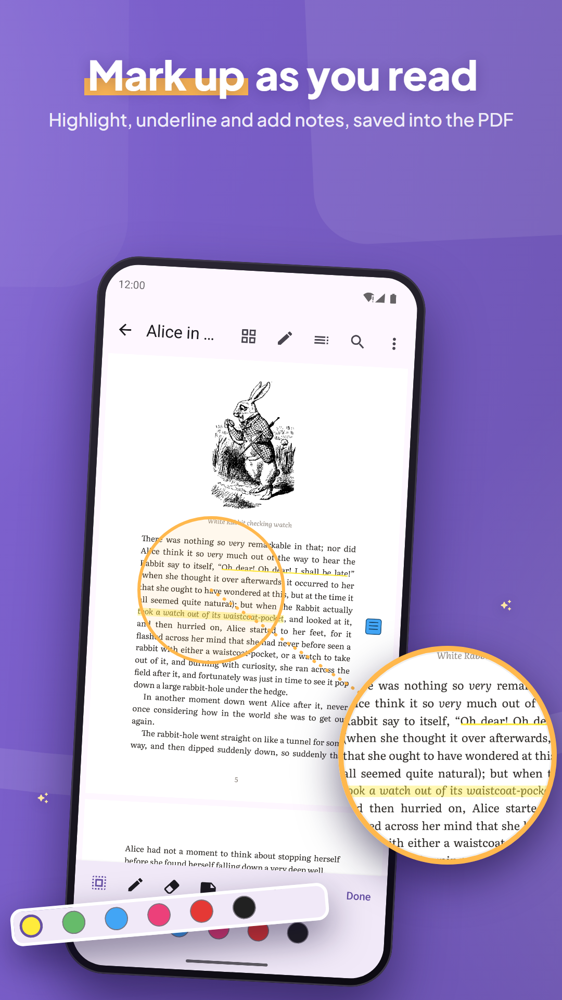
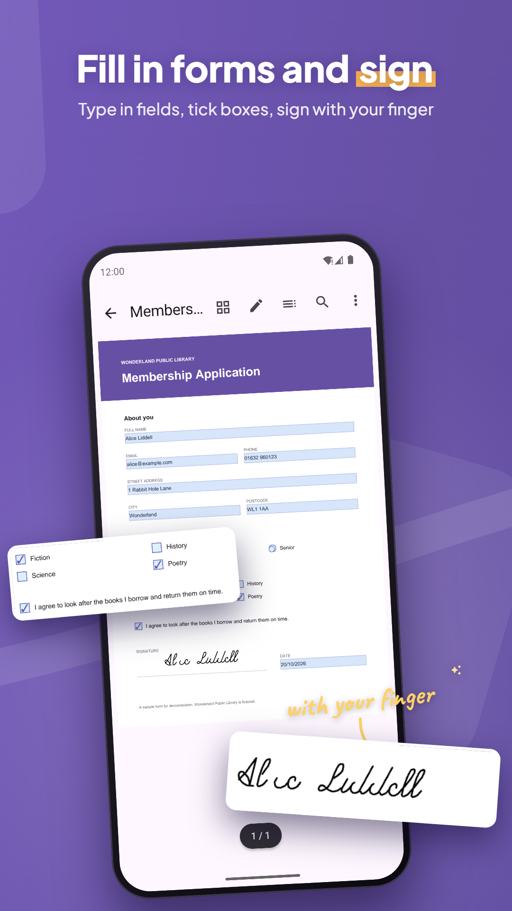
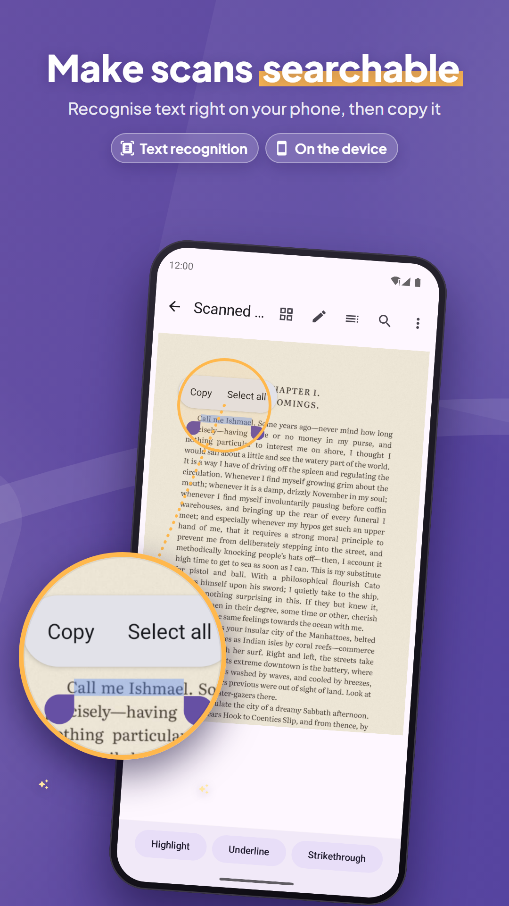
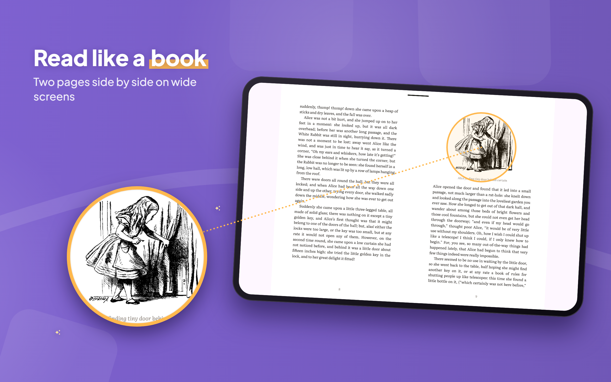
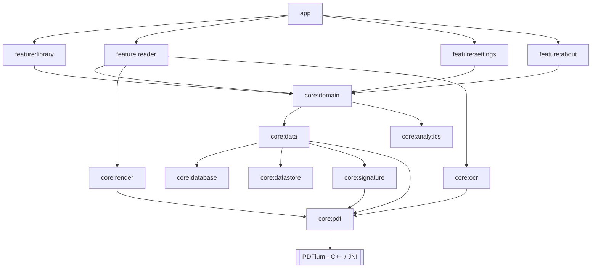

<p align="center">
  
</p>

<p align="center">
  
  
  
  
  
  
</p>

**TilePDF** is a PDF reader and editor for Android: read, highlight, fill in
forms, sign, recognise text on scans. It has no ads and no account, and your
documents never leave the phone. It doesn't wrap a ready-made viewer. It runs
on its own build of PDFium, the engine inside Chrome, through a JNI layer, with
a tile renderer written from scratch on top.

<table>
  <tr>
    <td></td>
    <td></td>
    <td></td>
    <td></td>
  </tr>
</table>
<p align="center">
  
</p>

## Under the hood

- **Its own PDFium build.** A fork of `pdfium-binaries` builds PDFium with V8
  and XFA for four ABIs, with patches of my own for Android: form fallback
  fonts, number formatting, XFA focus and XML output. Every call goes through
  one dedicated thread, because V8 is bound to the thread that started it.
  → [PDF engine](docs/ARCHITECTURE.md#pdf-engine)
- **A tile renderer.** Pages are drawn as 512 px tiles over an instant
  low-resolution draft, at fixed zoom levels so tiles only ever scale down.
  Tiles stay in a byte-bounded LRU cache and a bitmap pool, and tile jobs
  that scroll off screen are cancelled.
  → [Rendering](docs/ARCHITECTURE.md#rendering-pipeline) ·
  [Memory](docs/ARCHITECTURE.md#memory-strategy)
- **Real zoom on every frame.** Pinch zoom lays the pages out again on every
  frame, with the content under your fingers staying put. Measured with
  Perfetto on a Galaxy A52: a median frame time of about 12 ms.
- **Edits written into the PDF.** Highlights, ink, notes, form values and
  recognised text wait as a Room draft, then a WorkManager job saves them
  incrementally into the file, encrypted files included. Undo and redo work
  before the save.
  → [Saving](docs/ARCHITECTURE.md#saving-annotations)
- **The hard parts of PDF.** AcroForm filling with form JavaScript (V8), XFA
  forms, and digital-signature checks against Android's own CA store (PKIX).
  Text recognition runs on the device with ML Kit and is written back as an
  invisible text layer, so scanned pages become searchable and selectable.
- **Privacy enforced by the build.** A Gradle task fails the release build if
  the merged manifest asks for any permission outside an allowlist. Crash
  reports can be turned off, statistics need a yes first, and there is no
  advertising ID.
- **Ready for the Play Store.** R8, 16 KB-aligned native libraries, R8
  mappings and native symbols uploaded to Crashlytics, English and Turkish,
  TalkBack labels, and layouts for tablets and foldables.

## Architecture



Modules follow [Now in Android](https://github.com/android/nowinandroid):
unidirectional data flow with ViewModels exposing `StateFlow<UiState>`,
repositories behind interfaces, Hilt, and shared Gradle setup in convention
plugins (`build-logic/`). Feature modules never depend on each other.

## Quality

- Test-driven development: **481 unit tests** (ViewModels, use cases,
  repositories, zoom and tile math, text search and selection) and **191
  instrumented tests** (PDFium rendering, stitched tiles matching a whole-page
  render, Room migrations, the save worker, accessibility checks).
- The build logic tests itself too: the permission allowlist, upload-key
  signing and the store listing (Play's text limits and image rules).
- Release builds were tried on a real arm64 phone, not just on emulators.
  → [Testing](docs/ARCHITECTURE.md#testing)

## Build

```sh
./gradlew assembleDebug        # needs the Android SDK and NDK; PDFium is downloaded and checked by hash
./gradlew testDebugUnitTest
```

Firebase is optional: without `app/google-services.json` the app builds and
sends nothing.

## More

[Technical notes](docs/ARCHITECTURE.md) ·
[Releasing](docs/RELEASING.md) ·
[Privacy policy](https://mustafakoceerr.github.io/TilePDF/privacy/) ·
[How the store graphics are made](fastlane/design/README.md)

## License

[Apache 2.0](LICENSE). Bundled third-party code keeps its own license; see
[NOTICE](NOTICE) and the in-app list under Settings → About.
